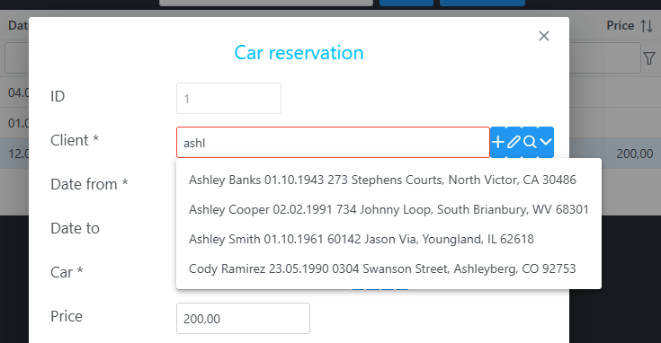

# Concepts

Chilibase apps are model-driven. You create database tables, map them with TypeORM entities, and build the UI on those entities. Browse screens and forms use the same entity names and the same field names as the classes on the backend.

On this page, entity names are gold, like <Entity>Car</Entity>, and field names are green, like <Field>color</Field>. A green name in a form or a browse is the same property as on the entity.

## Building an app

1. Create database tables and foreign keys between them.
2. Create TypeORM entities mapped onto those tables. An entity is a class with fields and with `ManyToOne` / `OneToMany` associations. The entities are the data model. The frontend follows that model. The framework uses it to build the SQL that loads and saves rows.
3. Build the UI. The two main pieces are:
   - **Browse** — a list of rows of one entity. Filter, sort, page, and remove rows.
   - **Form** — insert or update the selected row.

Both work over the entities, fields, and associations declared on the backend.

## Example: car reservations

[car-demo](https://github.com/chilibase/car-demo) has three main entities: <Entity>CarReservation</Entity>, <Entity>Car</Entity>, and <Entity>Client</Entity>.

<Entity>CarReservation</Entity> has fields <Field>dateFrom</Field>, <Field>dateTo</Field>, and <Field>price</Field>, a many-to-one association <Field>car</Field> to <Entity>Car</Entity>, and a many-to-one association <Field>client</Field> to <Entity>Client</Entity>.

<Entity>Car</Entity> also has a many-to-one association <Field>brandAssoc</Field> to <Entity>Brand</Entity>. The snippets below are the tables and entities that example uses. Browse and form listings are shortened; the full screens are [`CarReservationBrowse.tsx`](https://github.com/chilibase/car-demo/blob/main/frontend/src/forms/CarReservationBrowse.tsx) and [`CarReservationForm.tsx`](https://github.com/chilibase/car-demo/blob/main/frontend/src/forms/CarReservationForm.tsx).

<details class="cb-fold">
<summary>

## Tables
</summary>

Tables live in schema `car_demo`. <Entity>Brand</Entity> is included because <Field>car.brandAssoc</Field> points at it. `x_user` is the framework user table (`modif_x_user_id`).

```sql
-- app tables (create in schema car_demo)

CREATE TABLE brand (
  id SERIAL PRIMARY KEY,
  brand varchar NOT NULL
);

CREATE TABLE car (
  id SERIAL PRIMARY KEY,
  vin varchar NOT NULL,
  brand_string varchar,
  year int,
  color varchar,
  price DECIMAL(12,2),
  car_date DATE,
  car_datetime TIMESTAMP,
  car_boolean BOOLEAN NOT NULL DEFAULT false,
  comment varchar,
  brand_id int,
  modif_date TIMESTAMP,
  modif_x_user_id int,
  version int NOT NULL
);

CREATE TABLE client (
  id SERIAL PRIMARY KEY,
  name varchar NOT NULL,
  birth_date DATE,
  contact varchar,
  address varchar,
  modif_date TIMESTAMP,
  modif_x_user_id int,
  version int NOT NULL
);

CREATE TABLE car_reservation (
  id SERIAL PRIMARY KEY,
  date_from DATE NOT NULL,
  date_to DATE,
  price DECIMAL(12,2),
  comment varchar,
  car_id int NOT NULL,
  client_id int NOT NULL,
  modif_date TIMESTAMP,
  modif_x_user_id int,
  version int NOT NULL
);

ALTER TABLE car ADD FOREIGN KEY (brand_id) REFERENCES brand (id);
CREATE INDEX ON car (brand_id);
ALTER TABLE car ADD FOREIGN KEY (modif_x_user_id) REFERENCES x_user (id);
CREATE INDEX ON car (modif_x_user_id);

ALTER TABLE client ADD FOREIGN KEY (modif_x_user_id) REFERENCES x_user (id);
CREATE INDEX ON client (modif_x_user_id);

ALTER TABLE car_reservation ADD FOREIGN KEY (car_id) REFERENCES car (id);
CREATE INDEX ON car_reservation (car_id);
ALTER TABLE car_reservation ADD FOREIGN KEY (client_id) REFERENCES client (id);
CREATE INDEX ON car_reservation (client_id);
ALTER TABLE car_reservation ADD FOREIGN KEY (modif_x_user_id) REFERENCES x_user (id);
CREATE INDEX ON car_reservation (modif_x_user_id);
```

Column names in the database are snake_case (`date_from`). Entity fields are camelCase (<Field>dateFrom</Field>). `@Column({ name: 'date_from' })` connects the two. Browse columns and form fields use the camelCase name.

</details>

<details class="cb-fold">
<summary>

## Entities

</summary>

`@ManyToOne` / `@OneToMany` are the associations. The property name (<Field>client</Field>, <Field>car</Field>, <Field>brandAssoc</Field>) is what the UI uses in a field path.

### CarReservation

```ts
import {
  Column,
  Entity,
  JoinColumn,
  ManyToOne,
  PrimaryGeneratedColumn,
  VersionColumn
} from 'typeorm'
import { User } from '@chilibase/backend/administration'
import { Car } from './car.entity.js'
import { Client } from './client.entity.js'

@Entity()
export class CarReservation {
  @PrimaryGeneratedColumn()
  id: number

  @Column({ name: 'date_from', type: 'date', nullable: false })
  dateFrom: Date | null

  @Column({ name: 'date_to', type: 'date', nullable: true })
  dateTo: Date | null

  @Column({ type: 'numeric', precision: 12, scale: 2, nullable: true })
  price: number | null

  @Column({ nullable: true })
  comment: string | null

  @ManyToOne(() => Car, { nullable: false })
  @JoinColumn([{ name: 'car_id', referencedColumnName: 'id' }])
  car: Car

  @ManyToOne(() => Client, { nullable: false })
  @JoinColumn([{ name: 'client_id', referencedColumnName: 'id' }])
  client: Client

  @Column('timestamp without time zone', { name: 'modif_date', nullable: true })
  modifDate: Date | null

  @ManyToOne(() => User, { nullable: true })
  @JoinColumn([{ name: 'modif_x_user_id', referencedColumnName: 'id' }])
  modifUser: User | null

  @VersionColumn()
  version: number
}
```

### Car

```ts
import {
  Column,
  Entity,
  JoinColumn,
  ManyToOne,
  OneToMany,
  PrimaryGeneratedColumn,
  VersionColumn
} from 'typeorm'
import { User } from '@chilibase/backend/administration'
import { Brand } from './brand.entity.js'
import { Ride } from './ride.entity.js'

@Entity()
export class Car {
  @PrimaryGeneratedColumn()
  id: number

  @Column({ nullable: false })
  vin: string

  @Column({ name: 'brand_string', nullable: true })
  brandString: string | null

  @Column({ width: 4, nullable: true })
  year: number | null

  @Column({ nullable: true })
  color: string | null

  @Column({ type: 'numeric', precision: 12, scale: 2, nullable: true })
  price: number | null

  @Column({ name: 'car_date', type: 'date', nullable: true })
  carDate: Date | null

  @Column('timestamp without time zone', { name: 'car_datetime', nullable: true })
  carDatetime: Date | null

  @Column({ name: 'car_boolean', nullable: false })
  carBoolean: boolean

  @Column({ nullable: true })
  comment: string | null

  @ManyToOne(() => Brand, { nullable: true })
  @JoinColumn({ name: 'brand_id', referencedColumnName: 'id' })
  brandAssoc: Brand | null

  @OneToMany('Ride', 'car', { cascade: ['insert', 'update', 'remove'] })
  rideList: Ride[]

  @Column('timestamp without time zone', { name: 'modif_date', nullable: true })
  modifDate: Date | null

  @ManyToOne(() => User, { nullable: true })
  @JoinColumn([{ name: 'modif_x_user_id', referencedColumnName: 'id' }])
  modifUser: User | null

  @VersionColumn()
  version: number
}
```

### Brand

```ts
import { Column, Entity, PrimaryGeneratedColumn } from 'typeorm'

@Entity()
export class Brand {
  @PrimaryGeneratedColumn()
  id: number

  @Column({ nullable: false })
  brand: string
}
```

### Client

```ts
import {
  Column,
  Entity,
  JoinColumn,
  ManyToOne,
  PrimaryGeneratedColumn,
  VersionColumn
} from 'typeorm'
import { User } from '@chilibase/backend/administration'

@Entity()
export class Client {
  @PrimaryGeneratedColumn()
  id: number

  @Column({ nullable: false })
  name: string | null

  @Column({ name: 'birth_date', type: 'date', nullable: true })
  birthDate: Date | null

  @Column({ nullable: true })
  contact: string | null

  @Column({ nullable: true })
  address: string | null

  @Column('timestamp without time zone', { name: 'modif_date', nullable: true })
  modifDate: Date | null

  @ManyToOne(() => User, { nullable: true })
  @JoinColumn([{ name: 'modif_x_user_id', referencedColumnName: 'id' }])
  modifUser: User | null

  @VersionColumn()
  version: number
}
```

</details>

## Browse

A browse is a thin wrapper around `LazyDataTable`. This one lists <Entity>CarReservation</Entity> rows. `EditForm` adds the Add and Edit buttons and opens `CarReservationForm` in a dialog. The table is sorted by <Field>id</Field> descending and loads 30 rows per page.

```tsx
import {
  Column,
  LazyDataTable,
  type SearchBrowseProps
} from '@chilibase/frontend/lazy-data-table'
import { CarReservationForm } from './CarReservationForm'
import { ClientForm } from './ClientForm'

export const CarReservationBrowse = (props: SearchBrowseProps) => {
  return (
    <div>
      <LazyDataTable
        entity="CarReservation"
        label="Car reservations"
        rows={30}
        sortField="id desc"
        EditForm={CarReservationForm}
        onRemoveRow={true}
        searchBrowseParams={props.searchBrowseParams}
      >
        <Column field="id" header="ID" width="5rem" />
        <Column
          field="client.name"
          header="Client"
          width="15rem"
          autoFilter
          autoComplete={{
            assocField: 'client',
            field: 'name',
            ValueForm: ClientForm,
            lazyLoadMaxRows: 15,
            scrollHeight: '25rem'
          }}
        />
        <Column field="dateFrom" header="Date from" />
        <Column field="dateTo" header="Date to" />
        <Column field="car.id" header="Car ID" width="5rem" />
        <Column field="car.brandAssoc.brand" header="Car brand" width="10rem" />
        <Column field="car.color" header="Car color" width="10rem" />
        <Column field="price" header="Price" />
        <Column field="comment" header="Comment" width="15rem" textFormat="multiline" />
      </LazyDataTable>
    </div>
  )
}
```

`entity="CarReservation"` is the entity. Each `Column` displays one field of that entity.

A field is either a single property, such as <Field>dateFrom</Field>, or a field path, such as <Field>client.name</Field>. A path is made of associations (usually many-to-one, sometimes one-to-many) and ends with a simple field on the target entity. In <Field>client.name</Field>, <Field>client</Field> is the many-to-one association on <Entity>CarReservation</Entity> that points at <Entity>Client</Entity>, and <Field>name</Field> is a field of <Entity>Client</Entity>.

`LazyDataTable` filters, sorts, and lazy-loads. Only the first 30 rows are fetched. The backend walks the entity model and builds the SQL. Associated rows (for example <Entity>Client</Entity>) are joined when the column path needs them.

## Form

A form edits one row. It is bound to one entity and renders that entity's fields with field components.

```tsx
import { TextField } from '@chilibase/frontend/text-field'
import { NumberField } from '@chilibase/frontend/number-field'
import { FormFooter, FormHeader, FormBaseModif } from '@chilibase/frontend/form'
import { MultilineTextField } from '@chilibase/frontend/multiline-text-field'
import { DateField } from '@chilibase/frontend/date-field'
import { AutocompleteField } from '@chilibase/frontend/autocomplete-field'
import { ClientBrowse } from './ClientBrowse'
import { ClientForm } from './ClientForm'
import { CarBrowse } from './CarBrowse'
import { CarForm } from './CarForm'
import type { FormProps } from '@chilibase/frontend/form'
import type { CarReservation } from '../model/car-reservation.entity'
import { FormCol, FormRow } from '@chilibase/frontend/form-layout'

export class CarReservationForm extends FormBaseModif {
  constructor(props: FormProps) {
    super(props, 'CarReservation')
  }

  render() {
    return (
      <div>
        <FormHeader form={this} label="Car reservation" />
        <FormRow>
          <FormCol>
            <NumberField form={this} field="id" label="ID" readOnly />
            <AutocompleteField
              form={this}
              assocField="client"
              label="Client"
              width="30rem"
              displayField={['name', 'birthDate', 'address']}
              sortField="name"
              scrollHeight="25rem"
              suggestionsLoad="lazy"
              SearchBrowse={ClientBrowse}
              AssocForm={ClientForm}
            />
            <DateField form={this} field="dateFrom" label="Date from" />
            <DateField form={this} field="dateTo" label="Date to" />
            <AutocompleteField
              form={this}
              assocField="car"
              label="Car"
              displayField={['id', 'brandAssoc.brand', 'color']}
              scrollHeight="25rem"
              suggestionsLoad="lazy"
              SearchBrowse={CarBrowse}
              AssocForm={CarForm}
            />
            <NumberField form={this} field="price" label="Price" />
            <MultilineTextField form={this} field="comment" label="Comment" rows={2} autoResize />
            <DateField form={this} field="modifDate" label="Modified at" readOnly />
            <TextField
              form={this}
              field="modifUser.name"
              label="Modified by"
              readOnly
              inputStyle={{ width: '12.5rem' }}
            />
          </FormCol>
        </FormRow>
        <FormFooter form={this} />
      </div>
    )
  }
}

// static — can be called without an instance
(CarReservationForm as any).createObject = async (): Promise<CarReservation> => {
  return { version: 0, price: 32200 } as CarReservation
}

// static — can be called without an instance
(CarReservationForm as any).assocList = (): string[] => {
  return ['client', 'car.brandAssoc', 'modifUser']
}
```

Scalar components edit one field. For example `DateField` with `field="dateFrom"` edits <Field>dateFrom</Field> on the <Entity>CarReservation</Entity> row.

Many-to-one components set an association. For example `AutocompleteField` with `assocField="client"` sets many-to-one association <Field>client</Field> on <Entity>CarReservation</Entity>, which points at <Entity>Client</Entity>. `displayField={['name', 'birthDate', 'address']}` is the list of <Entity>Client</Entity> fields shown in the input: <Field>name</Field>, <Field>birthDate</Field>, and <Field>address</Field>, joined with a space.

With `suggestionsLoad="lazy"`, when user types a text in the input, a search in the database is invoked to find suggestions. Suggestions are <Entity>Client</Entity> rows. A row matches when one of the displayed fields contains the typed text. 
If the user has typed more values separated by space, every value must be found in some of the displayed fields.
The more values the user types, the narrower (more exact) is the search (like web search).

Lazy searching (search performed on DB using ILIKE operator) enables to use AutocompleteField component also for entities with many rows (10 000 works well).
For millions of rows, PostgreSQL Full-Text Search feature should be considered to avoid full table scan (option to improve the framework).

Client autocomplete opened when text “ashl” typed:


`AutocompleteField` also has four buttons for the associated row:

| Button | Icon | What it does                                                                                                                                                                                                                                              |
| --- | --- |-----------------------------------------------------------------------------------------------------------------------------------------------------------------------------------------------------------------------------------------------------------|
| **Plus** | `pi-plus` | Creates a new row of the associated entity. Opens the form from prop `AssocForm` (here `ClientForm`). After Save, the row is inserted into DB and written into association <Field>client</Field> on the <Entity>CarReservation</Entity> row that is open. |
| **Pencil** | `pi-pencil` | Edits the associated row. Opens the form from prop `AssocForm` (here `ClientForm`) and reloads that row from the database.                                                                                                                                |
| **Search** | `pi-search` | Opens the browse from prop `SearchBrowse` (here `ClientBrowse`) so you can search and pick the row. This is the other way to choose a row, next to typing in the input.                                                                                   |
| **Dropdown** | `pi-chevron-down` | Opens the suggestion list. With lazy search only the first 10 rows are loaded (`lazyLoadMaxRows`, default 10).                                                                                                                                            |

`ClientForm` and `ClientBrowse` open in a modal dialog, so you continue editing the <Entity>CarReservation</Entity> row after the dialog closes.

`AutocompleteField` is one of the main pieces of the framework: you can work with associated rows even when the target entity row count is fairly large.

## Associated rows (`assocList`)

```ts
(CarReservationForm as any).assocList = (): string[] => {
  return ['client', 'car.brandAssoc', 'modifUser']
}
```

`assocList` tells the form that it is not enough to load only <Entity>CarReservation</Entity> row but we need to load also associated rows on many-to-one associations. These many-to-one paths are loaded with the main row (join is used on the backend):

- <Field>client</Field> loads the <Entity>Client</Entity> row.
- <Field>car.brandAssoc</Field> loads the <Entity>Car</Entity> row and the <Entity>Brand</Entity> row.
- <Field>modifUser</Field> loads the <Entity>User</Entity> row.

Without those rows the object is incomplete, and fields of the associated objects (<Field>name</Field>, <Field>birthDate</Field>, <Field>address</Field>, and the rest) stay empty on the form.

`createObject` supplies the insert defaults (<Field>version</Field> and <Field>price</Field> above).

## The row sent to the backend

`EditForm={CarReservationForm}` on `LazyDataTable` creates the Add and Edit buttons. They open `CarReservationForm` in a modal dialog, the same way `AutocompleteField` opens its form.

The form builds a <Entity>CarReservation</Entity> object during the edit and sends it to the backend when the user clicks Save:

```json
{
  "id": 1,
  "dateFrom": "2025-03-12",
  "dateTo": "2025-03-20",
  "price": "200.00",
  "comment": null,
  "client": {
    "id": 227,
    "name": "Ashley Cooper",
    "birthDate": "1991-02-02",
    "contact": "555-7369",
    "address": "734 Johnny Loop, South Brianbury, WV 68301",
    "modifDate": null,
    "version": 0
  },
  "car": {
    "id": 5,
    "vin": "09a06548",
    "brandString": "VW",
    "year": 1965,
    "color": "Red",
    "price": "123.11",
    "carDate": "2015-03-09",
    "carDatetime": "2015-03-22T00:00:00.000Z",
    "carBoolean": false,
    "comment": "line 1\nline 2\nline 3",
    "brandAssoc": {
      "id": 19,
      "brand": "BMW*"
    },
    "modifDate": "2025-03-11T18:06:43.000Z",
    "version": 3
  },
  "modifDate": "2026-09-25 19:19:11",
  "modifUser": {
    "id": 2,
    "username": "michalrakus@gmail.com",
    "password": null,
    "name": "Michal Rakus",
    "enabled": true,
    "admin": true,
    "modifDate": "2025-03-06T10:06:55.000Z",
    "version": 2
  },
  "version": 0
}
```

The keys are the same fields as on the entities: <Field>dateFrom</Field> and <Field>price</Field> on <Entity>CarReservation</Entity>, <Field>name</Field> on <Entity>Client</Entity>, <Field>brandAssoc</Field> and <Field>brand</Field> on <Entity>Car</Entity> / <Entity>Brand</Entity>, and <Field>modifUser</Field> pointing at <Entity>User</Entity>.

## Save, details, and locking

- Default save endpoint is `x-save-row`.
- One-to-many **detail rows** are saved with the master when TypeORM associations use `cascade: ["insert", "update", "remove"]`.
- **Optimistic locking** uses a TypeORM `@VersionColumn()` (`version`). A subscriber rejects the update if the version in the database does not match.
- **Pessimistic locking** (`lockDate` / `lockUser`) is implemented in persistence for entities that have those fields. It is optional and not required for typical apps. You can turn on pessimistic locking by setting third param in constructor of Form to true, e.g.: 
```ts
constructor(props: FormProps) {
  super(props, 'CarReservation', true); // true -> pessimistic locking turned on 
})
```
- `FormBaseModif` sets `modifDate` and `modifUser` before save.

## Prefix `X`

Framework objects often use prefix **X** so they do not clash with application names: tables (`x_user`, `x_file_meta`), CSS classes, some typescript objects (`XUtils`, `XUtilsCommon`).

## What is not in core yet

These exist in some apps or older library versions and can be moved into Chilibase on demand:

- `FormPanelList` (custom layout of detail rows)
- Excel / Word export via templates (`{assoc1.assoc2.fieldX}`)
- Statistics and runtime reporting modules

Day-to-day API detail is in [Browse](/features/browse) and [Forms](/features/forms).
